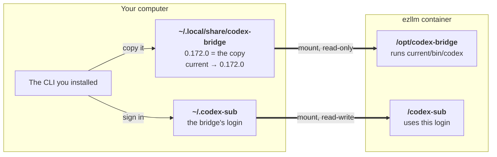

# Turn on a bridge

A bridge lets ezllm use a plan you already pay for, through that company's own
command-line app (its **CLI**). Open the page for your plan and follow it from top to
bottom. You do not need the others.

- **[Claude](bridges/claude.md)**
- **[ChatGPT (Codex)](bridges/codex.md)**
- **[GitHub Copilot](bridges/copilot.md)**
- **[Google Antigravity](bridges/antigravity.md)**

Not working? **[Troubleshooting](bridges/troubleshooting.md)**

## How it works

ezllm runs in a container, which is a closed box: **it cannot see the CLI you
installed.** So you copy the CLI into one folder, sign in to another, and hand both
folders to the box. Codex as the example:

## Later

- **Update a CLI:** redo **Install** and **Copy**, then `docker restart ezllm`. Or let
  the [updater](bridge-update-runbook.md) do it.
- **Turn a bridge off:** set it to `"off"` in `compose.yml` and run
  `docker compose up -d`. With `docker run`, start again without its block.
- **Every setting:** [environment.md](environment.md)
