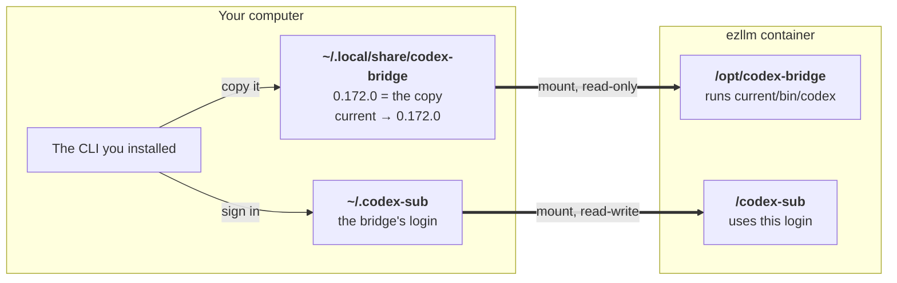
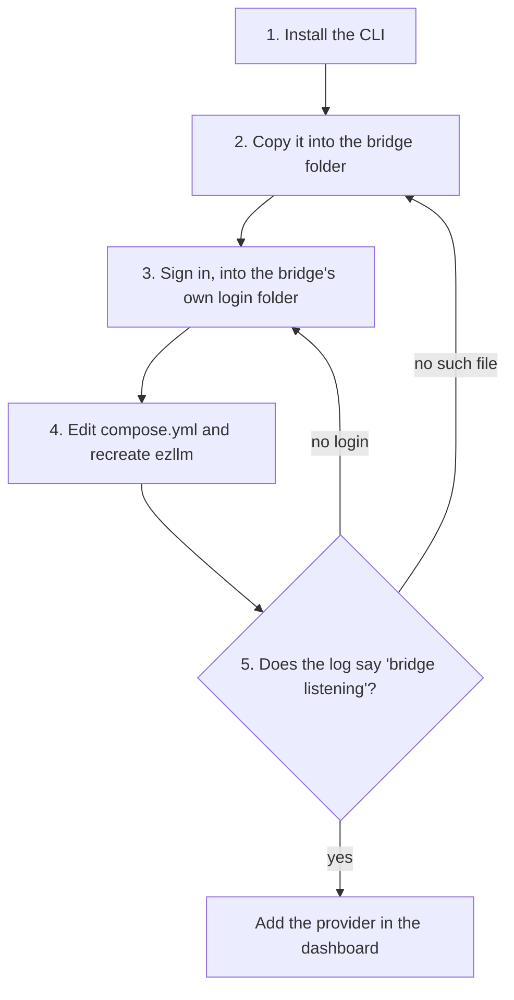

# Turn on a bridge, step by step

A bridge lets ezllm use a plan you already pay for (Claude, ChatGPT, Copilot or
Antigravity) through that company's own command-line app, the **CLI**. This page
takes a fresh Linux machine to a working bridge. Each bridge is optional: do only
the ones you want. Start with ezllm already running ([quick start](../README.md#quick-start)).

## The idea

ezllm runs in a container, a closed box. **It cannot see the CLI you installed on
your computer.** You make it two folders and hand them in:

1. a **copy of the CLI**, and
2. a **login** used only by the bridge.



| Bridge | ezllm looks for this file | Copy folder → container | Login folder → container |
|---|---|---|---|
| Claude | `/opt/claude-bridge/current/claude` | `~/.local/share/claude-bridge` → `/opt/claude-bridge` | `~/.claude-sub` → `/claude-sub` |
| Codex | `/opt/codex-bridge/current/bin/codex` | `~/.local/share/codex-bridge` → `/opt/codex-bridge` | `~/.codex-sub` → `/codex-sub` |
| Copilot | `/opt/copilot-bridge/current/copilot` | `~/.local/share/copilot-bridge` → `/opt/copilot-bridge` | `~/.copilot-sub` → `/copilot-sub` |
| Antigravity | `/opt/agy-bridge/current/agy` | `~/.local/share/agy-bridge` → `/opt/agy-bridge` | `~/.agy-sub` → `/agy-sub` |

**"No such file or directory" nearly always means that file is not there.** The
[checker](#step-5-check) finds out why.

## The five steps



Run steps 1–3 on the computer that runs Docker, as your normal user, not root.

### Step 1: install the CLI

| Bridge | Command |
|---|---|
| Claude | `curl -fsSL https://claude.ai/install.sh \| bash` |
| Codex | `curl -fsSL https://chatgpt.com/codex/install.sh \| sh` |
| Copilot | `curl -fsSL https://gh.io/copilot-install \| bash` |
| Antigravity | `curl -fsSL https://antigravity.google/cli/install.sh \| bash` |

Open a new terminal afterwards. **Use these installers, not npm.** An npm install
can give you a small script that needs Node.js, which the container does not have,
so it fails with "no such file or directory" even though you can see the file.

**Copilot on ezllm v2.2.0 or earlier:** skip this row and step 2, and use the
[1.0.112 install](copilot-bridge-runbook.md#install-the-cli-first-time) instead.
Newer Copilot releases need a newer ezllm.

### Step 2: copy it into the bridge folder

Paste the block for your bridge. Running it again later is how you update.

**Claude**

```sh
CLI=$(readlink -f "$(command -v claude)")
V=$("$CLI" --version | grep -oE '[0-9]+\.[0-9]+\.[0-9]+' | head -1)
DIR=~/.local/share/claude-bridge
mkdir -p "$DIR" ~/.claude-sub && chmod 700 ~/.claude-sub
[ -e "$DIR/$V" ] || { mkdir "$DIR/$V" && cp "$CLI" "$DIR/$V/claude" && chmod -R a-w "$DIR/$V"; }
ln -sfn "$V" "$DIR/current"
```

**Codex** (the whole folder, not one file)

```sh
REL=$(readlink -f ~/.codex/packages/standalone/current)
V=$("$REL/bin/codex" --version | grep -oE '[0-9]+\.[0-9]+\.[0-9]+' | head -1)
DIR=~/.local/share/codex-bridge
mkdir -p "$DIR" ~/.codex-sub && chmod 700 ~/.codex-sub
[ -e "$DIR/$V" ] || { cp -a "$REL" "$DIR/$V" && chmod -R a-w "$DIR/$V"; }
ln -sfn "$V" "$DIR/current"
```

**Copilot**

```sh
CLI=$(readlink -f "$(command -v copilot)")
V=$("$CLI" --version --no-auto-update | grep -oE '[0-9]+\.[0-9]+\.[0-9]+' | head -1)
DIR=~/.local/share/copilot-bridge
mkdir -p "$DIR" ~/.copilot-sub && chmod 700 ~/.copilot-sub
[ -e "$DIR/$V" ] || { mkdir "$DIR/$V" && cp "$CLI" "$DIR/$V/copilot" && chmod -R a-w "$DIR/$V"; }
ln -sfn "$V" "$DIR/current"
```

**Antigravity**

```sh
CLI=$(readlink -f "$(command -v agy)")
V=$("$CLI" --version | grep -oE '[0-9]+\.[0-9]+\.[0-9]+' | head -1)
DIR=~/.local/share/agy-bridge
mkdir -p "$DIR" ~/.agy-sub && chmod 700 ~/.agy-sub
[ -e "$DIR/$V" ] || { mkdir "$DIR/$V" && cp "$CLI" "$DIR/$V/agy" && chmod -R a-w "$DIR/$V"; }
ln -sfn "$V" "$DIR/current"
```

Why the odd parts: `current` must be a **short** link (`0.172.0`). A full path such
as `/home/you/…` does not exist inside the container. The copy is made read-only
because some CLIs update themselves in place.

### Step 3: sign in

| Bridge | Command |
|---|---|
| Claude | `CLAUDE_CONFIG_DIR=~/.claude-sub ~/.local/share/claude-bridge/current/claude auth login` |
| Codex | `CODEX_HOME=~/.codex-sub ~/.local/share/codex-bridge/current/bin/codex login --device-auth` |
| Copilot | `env -u DBUS_SESSION_BUS_ADDRESS COPILOT_HOME=~/.copilot-sub ~/.local/share/copilot-bridge/current/copilot login --device-code` |
| Antigravity | `env -u DBUS_SESSION_BUS_ADDRESS HOME=$HOME/.agy-sub ~/.local/share/agy-bridge/current/agy` then sign in, send one prompt, and type `/exit` |

Use these, not your everyday login: the bridge gets its own, so signing out of one
never breaks the other.

### Step 4: edit compose.yml

Add the lines for your bridge to the `ezllm` service, under the `environment:` and
`volumes:` it already has. Replace `/home/you` with your home folder (`echo $HOME`)
and write it out in full.

```yaml
    environment:
      EZLLM_CLAUDE_BRIDGE: "on"
      USER: you                # Claude only: your login name, both lines
      LOGNAME: you
      EZLLM_CODEX_BRIDGE: "on"
      EZLLM_COPILOT_BRIDGE: "on"
      XDG_CACHE_HOME: /data/copilot-cache   # Copilot only
      EZLLM_AGY_BRIDGE: "on"
    volumes:
      - /home/you/.local/share/claude-bridge:/opt/claude-bridge:ro
      - /home/you/.claude-sub:/claude-sub
      - /home/you/.local/share/codex-bridge:/opt/codex-bridge:ro
      - /home/you/.codex-sub:/codex-sub
      - /home/you/.local/share/copilot-bridge:/opt/copilot-bridge:ro
      - /home/you/.copilot-sub:/copilot-sub
      - /home/you/.local/share/agy-bridge:/opt/agy-bridge:ro
      - /home/you/.agy-sub:/agy-sub
```

- The container must run as you, or it cannot read the logins.
  `compose.example.yml` uses `1000:1000`. If `id -u` or `id -g` prints something
  else, put `UID=` and `GID=` with your numbers in a `.env` file next to
  `compose.yml`. Your `data` folder must belong to the same user.
- Leave the `EZLLM_*_BIN` settings out. The defaults are the paths in the table.
- Turn on one bridge at a time: **a bridge that cannot start stops ezllm**.

```sh
docker compose up -d --force-recreate ezllm
docker compose logs ezllm | grep -E "bridge listening|bridge:"
```

A working bridge prints one line like
`codex bridge listening addr=127.0.0.1:8791 cli=0.172.0 …`. `release=unqualified` is
fine: it means nobody has recorded a live test of that exact version. For Claude,
look for `login=logged-in` as well.

Then open the dashboard: **Providers → Add provider**, pick the bridge, and choose
**Save & validate key**. There is no key to paste.

### Step 5: check

Paste this on the computer that runs Docker. It only looks; it changes nothing.

```sh
for f in claude-bridge/current/claude codex-bridge/current/bin/codex \
         copilot-bridge/current/copilot agy-bridge/current/agy; do
  b=${f%%/*}; d=~/.local/share/$b; p=~/.local/share/$f
  if [ ! -d "$d" ]; then echo "--   $b: not set up"
  elif [ ! -L "$d/current" ]; then echo "BAD  $b: no 'current' link (step 2)"
  elif case "$(readlink "$d/current")" in /*) true;; *) false;; esac; then echo "BAD  $b: 'current' is a full path (step 2)"
  elif [ ! -f "$p" ]; then echo "BAD  $b: $p is missing (step 2)"
  elif [ "$(head -c 4 "$p" | tail -c 3)" != ELF ]; then echo "BAD  $b: a script, not the real program (step 1)"
  else echo "OK   $b $(readlink "$d/current")"; fi
done
```

## What the error means

| Log says | Why | Fix |
|---|---|---|
| `stat /opt/…-bridge/current/…: no such file or directory` | The copy is missing, `current` is a full path, or the folder is not mounted | Run the [checker](#step-5-check). All `OK`? Then the `volumes:` line is missing or mistyped |
| `fork/exec …: no such file or directory` | The file is there, but it is an npm script | Steps 1 and 2 with the installer above |
| `stat /home/…: no such file or directory` | An `EZLLM_*_BIN` names a path on your computer | Remove that setting |
| `no ChatGPT login`, `no Antigravity login` | Step 3 was skipped, or went to another folder | Step 3 |
| `is not a directory — mount the CLI's login home there` | The login folder is not mounted | The second `volumes:` line for that bridge |
| `Permission denied` | The container runs as another user | `user:` in step 4 |
| `speaks protocol 4, this bridge speaks 3` | ezllm v2.2.0 or earlier with a newer Copilot | The [1.0.112 install](copilot-bridge-runbook.md#install-the-cli-first-time), or a newer ezllm |

Two folders that look right and are not: `~/.codex/packages/standalone` (its
`current` is a full path) and `~/.local/bin` (no version folders). An **empty**
folder owned by root means Docker created it because the path in `volumes:` did not
exist: remove it and do step 2.

## More detail

[Claude](claude-bridge-runbook.md) · [Codex](codex-bridge-runbook.md) ·
[Copilot](copilot-bridge-runbook.md) · [Antigravity](agy-bridge-runbook.md) ·
[automatic CLI updates](bridge-update-runbook.md) ·
[every setting](environment.md)
