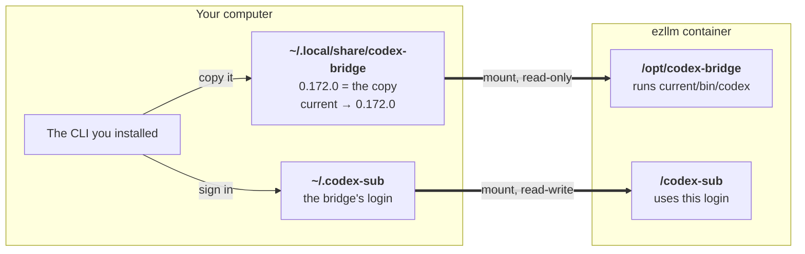

# Turn on a bridge

A bridge lets ezllm use a plan you already pay for, through that company's own
command-line app (its **CLI**). Pick your plan and follow that one recipe from top
to bottom. You do not need the others.

**[Claude](#claude) · [ChatGPT (Codex)](#chatgpt-codex) · [GitHub Copilot](#github-copilot) · [Google Antigravity](#google-antigravity)**

## Before you start

- You are on **Linux**, and ezllm already runs with **Docker Compose**
  ([quick start](../README.md#quick-start)).
- Run every command on that computer, as **yourself, not root**.
- In `compose.yml`, change `/home/you` to your home folder. `echo $HOME` prints it.
- `id -u` and `id -g` should both print `1000`. If not, put your numbers in a file
  named `.env` next to `compose.yml`: one line `UID=1001`, one line `GID=1001`.

## How it works

ezllm runs in a container, which is a closed box: **it cannot see the CLI you
installed.** So you copy the CLI into one folder, sign in to another, and hand both
folders to the box. Codex as the example:



Every recipe is the same five parts: **install, copy, sign in, compose.yml, start.**

---

## Claude

**1. Install**

```sh
curl -fsSL https://claude.ai/install.sh | bash
```

Close the terminal and open a new one.

**2. Copy** (the last line prints the version)

```sh
CLI=$(readlink -f "$(command -v claude)")
V=$("$CLI" --version | grep -oE '[0-9]+\.[0-9]+\.[0-9]+' | head -1)
DIR=~/.local/share/claude-bridge
mkdir -p "$DIR" ~/.claude-sub && chmod 700 ~/.claude-sub
[ -e "$DIR/$V" ] || { mkdir "$DIR/$V" && cp "$CLI" "$DIR/$V/claude" && chmod -R a-w "$DIR/$V"; }
ln -sfn "$V" "$DIR/current"
"$DIR/current/claude" --version
```

**3. Sign in**

```sh
CLAUDE_CONFIG_DIR=~/.claude-sub ~/.local/share/claude-bridge/current/claude auth login
```

**4. compose.yml.** Add these lines to the `ezllm` service, under the `environment:`
and `volumes:` it already has. `USER` and `LOGNAME` are your login name (`whoami`).

```yaml
    environment:
      EZLLM_CLAUDE_BRIDGE: "on"
      USER: you
      LOGNAME: you
    volumes:
      - /home/you/.local/share/claude-bridge:/opt/claude-bridge:ro
      - /home/you/.claude-sub:/claude-sub
```

**5. Start**

```sh
docker compose up -d --force-recreate ezllm
docker compose logs ezllm | grep -i "claude bridge"
```

You should see `claude bridge listening` and, on the same line, `login=logged-in`.
Now [add it in the dashboard](#add-it-in-the-dashboard).

---

## ChatGPT (Codex)

**1. Install.** Use this installer, not npm: npm gives you a script the container
cannot run.

```sh
curl -fsSL https://chatgpt.com/codex/install.sh | sh
```

**2. Copy** (the whole folder; the last line prints the version)

```sh
REL=$(readlink -f ~/.codex/packages/standalone/current)
V=$("$REL/bin/codex" --version | grep -oE '[0-9]+\.[0-9]+\.[0-9]+' | head -1)
DIR=~/.local/share/codex-bridge
mkdir -p "$DIR" ~/.codex-sub && chmod 700 ~/.codex-sub
[ -e "$DIR/$V" ] || { cp -a "$REL" "$DIR/$V" && chmod -R a-w "$DIR/$V"; }
ln -sfn "$V" "$DIR/current"
"$DIR/current/bin/codex" --version
```

**3. Sign in.** It prints a web address and a code: open the address, enter the code.

```sh
CODEX_HOME=~/.codex-sub ~/.local/share/codex-bridge/current/bin/codex login --device-auth
```

**4. compose.yml.** Add these lines to the `ezllm` service, under the `environment:`
and `volumes:` it already has.

```yaml
    environment:
      EZLLM_CODEX_BRIDGE: "on"
    volumes:
      - /home/you/.local/share/codex-bridge:/opt/codex-bridge:ro
      - /home/you/.codex-sub:/codex-sub
```

**5. Start**

```sh
docker compose up -d --force-recreate ezllm
docker compose logs ezllm | grep -i "codex bridge"
```

You should see `codex bridge listening`. Now
[add it in the dashboard](#add-it-in-the-dashboard).

---

## GitHub Copilot

**1 and 2. Install and copy**, in one block. It downloads the CLI straight into the
bridge folder and leaves any Copilot you already use alone. 1.0.112 works with every
ezllm version. On an ezllm newer than v2.2.0 you can write `V=1.0.114`.

```sh
V=1.0.112
ASSET=copilot-linux-x64.tar.gz      # on ARM: copilot-linux-arm64.tar.gz
URL="https://github.com/github/copilot-cli/releases/download/v$V"
DIR=~/.local/share/copilot-bridge
mkdir -p "$DIR/$V" ~/.copilot-sub && chmod 700 ~/.copilot-sub
cd "$(mktemp -d)"
curl -fLO "$URL/$ASSET" && curl -fLO "$URL/SHA256SUMS.txt" &&
  sha256sum -c --ignore-missing SHA256SUMS.txt &&
  tar xzf "$ASSET" -C "$DIR/$V" &&
  ln -sfn "$V" "$DIR/current"
"$DIR/current/copilot" --no-auto-update --version
```

**3. Sign in.** It prints a web address and a code: open the address, enter the code.

```sh
env -u DBUS_SESSION_BUS_ADDRESS COPILOT_HOME=~/.copilot-sub \
  ~/.local/share/copilot-bridge/current/copilot login --device-code
```

**4. compose.yml.** Add these lines to the `ezllm` service, under the `environment:`
and `volumes:` it already has.

```yaml
    environment:
      EZLLM_COPILOT_BRIDGE: "on"
      XDG_CACHE_HOME: /data/copilot-cache
    volumes:
      - /home/you/.local/share/copilot-bridge:/opt/copilot-bridge:ro
      - /home/you/.copilot-sub:/copilot-sub
```

**5. Start**

```sh
docker compose up -d --force-recreate ezllm
docker compose logs ezllm | grep -i "copilot bridge"
```

You should see `copilot bridge listening` and **no** line saying `channel unavailable`.
Now [add it in the dashboard](#add-it-in-the-dashboard).

---

## Google Antigravity

**1. Install**

```sh
curl -fsSL https://antigravity.google/cli/install.sh | bash
```

Close the terminal and open a new one.

**2. Copy** (the last line prints the version)

```sh
CLI=$(readlink -f "$(command -v agy)")
V=$("$CLI" --version | grep -oE '[0-9]+\.[0-9]+\.[0-9]+' | head -1)
DIR=~/.local/share/agy-bridge
mkdir -p "$DIR" ~/.agy-sub && chmod 700 ~/.agy-sub
[ -e "$DIR/$V" ] || { mkdir "$DIR/$V" && cp "$CLI" "$DIR/$V/agy" && chmod -R a-w "$DIR/$V"; }
ln -sfn "$V" "$DIR/current"
"$DIR/current/agy" --version
```

**3. Sign in.** This opens the app. Sign in, send any message, then type `/exit`.

```sh
env -u DBUS_SESSION_BUS_ADDRESS HOME=$HOME/.agy-sub ~/.local/share/agy-bridge/current/agy
```

**4. compose.yml.** Add these lines to the `ezllm` service, under the `environment:`
and `volumes:` it already has.

```yaml
    environment:
      EZLLM_AGY_BRIDGE: "on"
    volumes:
      - /home/you/.local/share/agy-bridge:/opt/agy-bridge:ro
      - /home/you/.agy-sub:/agy-sub
```

**5. Start**

```sh
docker compose up -d --force-recreate ezllm
docker compose logs ezllm | grep -i "agy bridge"
```

You should see `agy bridge listening`. Now
[add it in the dashboard](#add-it-in-the-dashboard).

---

## Add it in the dashboard

Open the dashboard → **Providers** → **Add provider** → pick your plan → **Save &
validate key**. There is no key to paste. The check sends a small message and uses a
little of your plan.

`release="unqualified …"` in the log is fine. It means nobody has recorded a live
test of that exact CLI version.

## It did not work

**A bridge that cannot start stops all of ezllm.** To get ezllm back, set that
bridge to `"off"` in `compose.yml` and run `docker compose up -d`. Then read the
reason with `docker compose logs ezllm` and find it here:

| The log says | Do this |
|---|---|
| `no such file or directory` | Run the checker below |
| `no ChatGPT login` or `no Antigravity login` | Redo **Sign in** |
| `login=logged-out` (Claude) | Redo **Sign in** |
| `is not a directory — mount the CLI's login home there` | Add the second `volumes:` line |
| `Permission denied` | Set `UID` and `GID` ([before you start](#before-you-start)) |
| `channel unavailable` (Copilot) | Use `V=1.0.112` and redo **Install and copy** |

**The checker.** Paste it on the computer that runs Docker. It only looks.

```sh
for f in claude-bridge/current/claude codex-bridge/current/bin/codex \
         copilot-bridge/current/copilot agy-bridge/current/agy; do
  b=${f%%/*}; d=~/.local/share/$b; p=~/.local/share/$f
  if [ ! -d "$d" ]; then echo "--   $b: not set up"
  elif [ ! -L "$d/current" ]; then echo "BAD  $b: no 'current' link (redo Copy)"
  elif case "$(readlink "$d/current")" in /*) true;; *) false;; esac; then echo "BAD  $b: 'current' is a full path (redo Copy)"
  elif [ ! -f "$p" ]; then echo "BAD  $b: $p is missing (redo Copy)"
  elif [ "$(head -c 4 "$p" | tail -c 3)" != ELF ]; then echo "BAD  $b: a script, not the real program (redo Install)"
  else echo "OK   $b $(readlink "$d/current")"; fi
done
```

- `OK` for your bridge, and ezllm still says `no such file or directory`? Then the
  `volumes:` line is missing or misspelled, or your `compose.yml` sets an
  `EZLLM_…_BIN`: remove it, the default is right.
- `BAD`? Redo the part it names.
- Is the folder empty and owned by root? Docker made it because the path in
  `volumes:` did not exist. Delete it and redo **Copy**.

## Later

- **Update a CLI:** run its installer and **Copy** again, then
  `docker compose restart ezllm`. Or let the [updater](bridge-update-runbook.md) do it.
- **Turn a bridge off:** set it to `"off"` and run `docker compose up -d`.
- **Everything else:** [Claude](claude-bridge-runbook.md) ·
  [Codex](codex-bridge-runbook.md) · [Copilot](copilot-bridge-runbook.md) ·
  [Antigravity](agy-bridge-runbook.md) · [all settings](environment.md)
